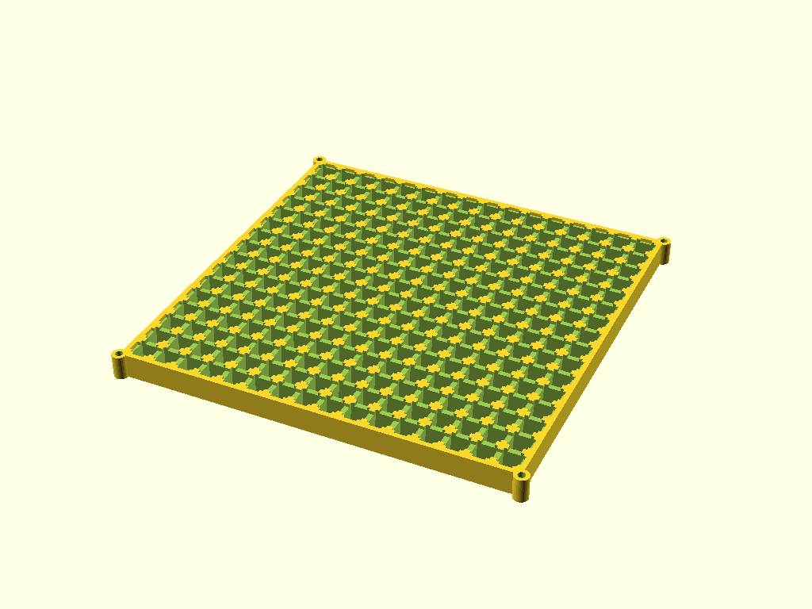
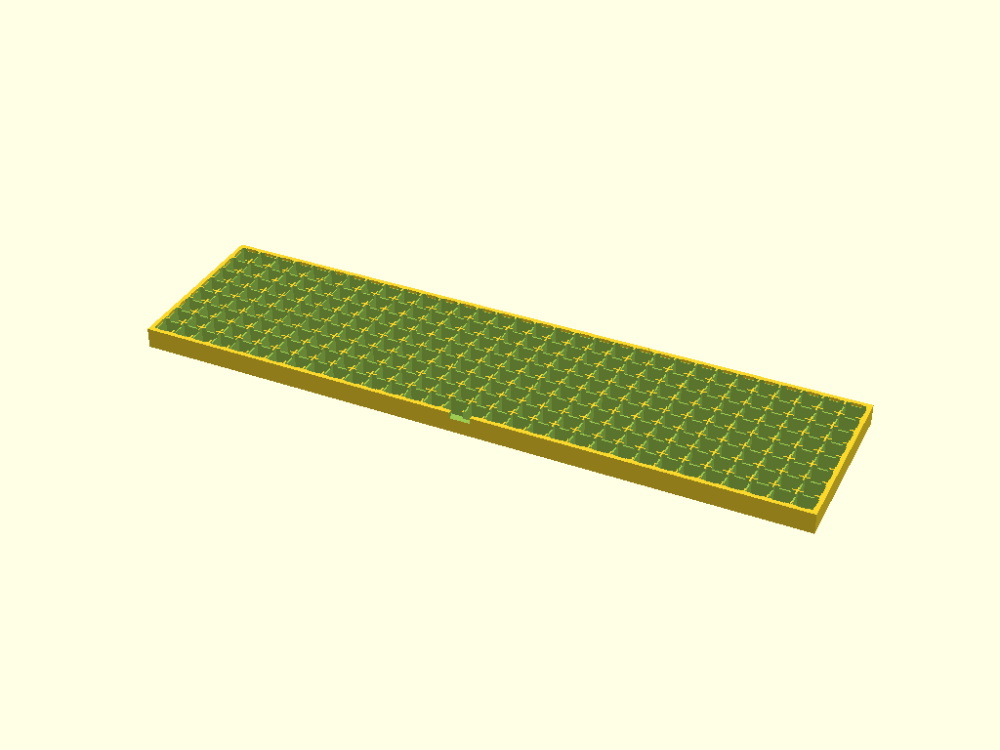
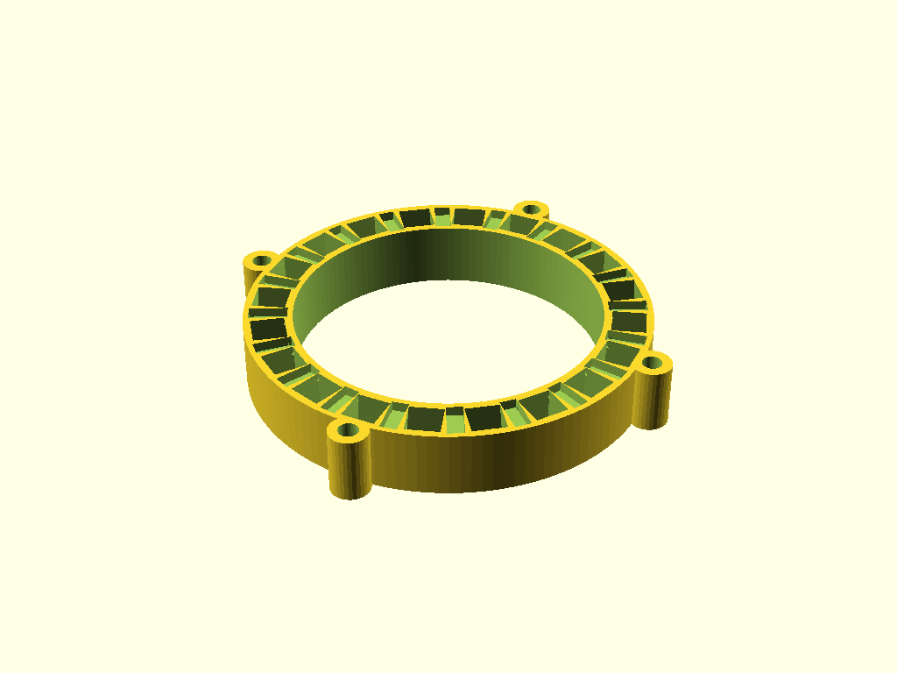

# NeoPixel Diffuser Generator

A parametric OpenSCAD generator for 3D-printable NeoPixel diffuser attachments.

## Live Preview
Explore the generated 3D models directly in your browser:
[https://chatelao.github.io/neopixel-diffusor-3d-print/](https://chatelao.github.io/neopixel-diffusor-3d-print/)

## Target Configurations

### 16x16 Matrix (160x160mm / 6.3x6.3")
- **Dimensions:** 160x160mm (6.3 x 6.3 inches)
- **LED Pitch:** 10mm
- **Layout:** 16 rows, 16 columns



### 8x32 Matrix (80x320mm / 3.15x12.6")
- **Dimensions:** 80x320mm (3.15 x 12.6 inches)
- **LED Pitch:** 10mm
- **Layout:** 8 rows, 32 columns



### 20-LED NeoPixel Ring (62mm OD)
- **Outer Diameter:** 62mm
- **Inner Diameter:** 47mm
- **LED Count:** 20



## Diffuser Versions

For each configured panel in `configs/panels.json`, the generator outputs three versions:
- **Version 1 (`_v1`):** Standard all-in-one print using the configured `bottom_thickness` (default `0.4mm`).
- **Version 2 (`_v2`):** Thicker all-in-one print with a fixed `0.7mm` top diffusion layer for stronger diffusion.
- **Version 3 (`_v3_body` & `_v3_lid`):** Two-part assembly consisting of a separate dark grid body (`part="body"`, recessed at the bottom with an outer retaining wall) and a `1.0mm` drop-in diffuser sheet (`part="diffuser"`).

## Usage

### Prerequisites
- OpenSCAD
- Python 3 (for automated generation and mesh verification)
- Xvfb (for headless PNG rendering on Linux)
- Admesh (optional, used by `verify_stls.py` alongside built-in manifold checks)

### Generating Files
To generate all STL and PNG files in parallel across CPU cores, run:
```bash
python3 scripts/generate_stl.py
```

To generate a specific panel or customize options:
```bash
python3 scripts/generate_stl.py --panel 16x16
python3 scripts/generate_stl.py --no-png --jobs 4
```

### Verifying Generated STLs
To verify that all generated STL meshes are 2-manifold, watertight, single-shell (`1` connected part), and resting flat on `z = 0`:
```bash
python3 scripts/verify_stls.py
```

## Customization
The OpenSCAD script `src/diffuser.scad` provides the following parameters for customization:

| Parameter | Default | Description |
|-----------|---------|-------------|
| `type` | `"matrix"` | Layout type: `"matrix"`, `"hex_matrix"`, or `"ring"`. |
| `part` | `"all"` | Component mode: `"all"` (monolithic), `"body"` (grid with lid recess), or `"diffuser"` (separate lid). |
| `led_pitch` | `10` | Center-to-center distance between LEDs (mm). |
| `tolerance` | `0.1` | Cavity fit offset (mm). |
| `lid_tolerance` | `0.2` | Perimeter clearance offset for the separate Version 3 lid (mm). |
| `wall_thickness` | `0.8` | Width of the dividing walls between LED cavities (mm). |
| `diffusion_height` | `10` | Total height from diffuser face (`z=0`) to PCB side (`z=diffusion_height`) (mm). |
| `bottom_thickness` | `0.4` | Thickness of the front optical diffusion layer (mm). |
| `cell_shape` | `"square"` | Cavity shape: `"square"`, `"circular"`, or `"hexagonal"`. |
| `draft_angle` | `0` | Taper angle of the cavity side walls (degrees). |
| `cap_clearance_enabled` | `false` | If `true`, adds cutouts on the PCB-facing side of cell walls for SMD capacitors. |
| `cap_clearance_width` | `2.5` | Width of the capacitor clearance cutout (mm). |
| `cap_clearance_height` | `1.5` | Depth of the capacitor clearance cutout from the PCB side (mm). |
| `frame_enabled` | `false` | If `true`, adds a reinforced outer perimeter frame. |
| `frame_width` | `2.0` | Thickness of the outer frame (mm). |
| `frame_radius` | `0.0` | Corner radius for rounded outer frames (mm). |
| `label_text` | `""` | Text to emboss on the outer vertical side of the bottom frame. |
| `label_size` | `5.0` | Font size (mm) for the frame label (clamped to fit frame height). |
| `label_depth` | `0.5` | Emboss depth (mm) for the frame label. |
| `cutout_enabled` | `false` | If `true`, adds cable routing cutouts on the PCB side of the frame. |
| `cutout_width` | `10` | Width of the cable cutout (mm). |
| `cutout_depth` | `3` | Depth of the cable cutout from the PCB side (mm). |
| `cutout_side` | `"bottom"` | Position of the cutout: `"left"`, `"right"`, `"top"`, `"bottom"` (matrix/hex) or `"inner"`, `"outer"` (ring). |
| `mounting_holes_enabled` | `false` | If `true`, adds external mounting tabs and through-holes. |
| `mounting_hole_dia` | `3.0` | Diameter of the mounting holes (mm). |
| `magnets_enabled` | `false` | If `true`, adds recesses on the PCB side of mounting tabs for neodymium magnets. |
| `magnet_dia` | `6.1` | Diameter of the magnet recesses (mm). |
| `magnet_depth` | `2.0` | Depth of the magnet recesses from the PCB side (mm). |
| `rows` | `16` | Total number of rows (`matrix` and `hex_matrix`). |
| `cols` | `16` | Total number of columns (`matrix` and `hex_matrix`). |
| `row_start` | `0` | Starting row index for segmented matrix generation. |
| `row_end` | `-1` | Ending row index for segmented matrix generation (`-1` uses `rows - 1`). |
| `col_start` | `0` | Starting column index for segmented matrix generation. |
| `col_end` | `-1` | Ending column index for segmented matrix generation (`-1` uses `cols - 1`). |
| `num_leds` | `20` | Number of LEDs (`ring` only). |
| `outer_diameter` | `62` | Outer diameter of the ring (mm). |
| `inner_diameter` | `47` | Inner diameter of the ring (mm). |
